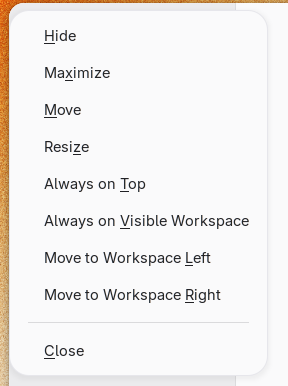

# Window Menu Keybinds

[](https://extensions.gnome.org)

Adds keyboard shortcuts to the window menu (Alt+Space / right-click title bar).

## Shortcuts

| Key | Action |
|-----|--------|
| **t** | Always on Top |
| **v** | Always on Visible Workspace |
| **c** | Close |
| **x** | Maximize |
| **e** | Restore |
| **h** | Hide |
| **m** | Move |
| **z** | Resize |
| **l** | Move to Workspace Left |
| **r** | Move to Workspace Right |

## Screenshots



## Installation

### From extensions.gnome.org (recommended)

Visit [extensions.gnome.org](https://extensions.gnome.org) and enable the extension.

### From source

```sh
git clone https://github.com/sugarycandybar/gnome-shell-extension-window-menu-keybinds.git \
  ~/.local/share/gnome-shell/extensions/window-menu-keybinds@sugarycandybar.github.io
```

Then enable the extension using [GNOME Extensions](https://gitlab.gnome.org/GNOME/gnome-shell/-/tree/main/subprojects/extensions-app) or:

```sh
gnome-extensions enable window-menu-keybinds@sugarycandybar.github.io
```

## Compatibility

- GNOME Shell 45 – 51

## License

GPL-3.0-or-later
